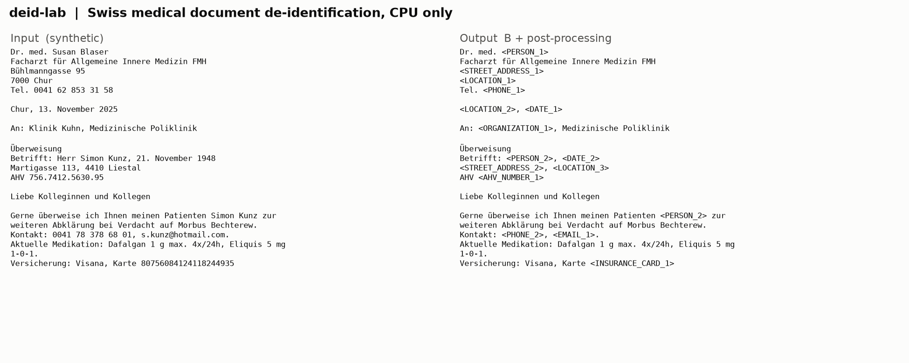
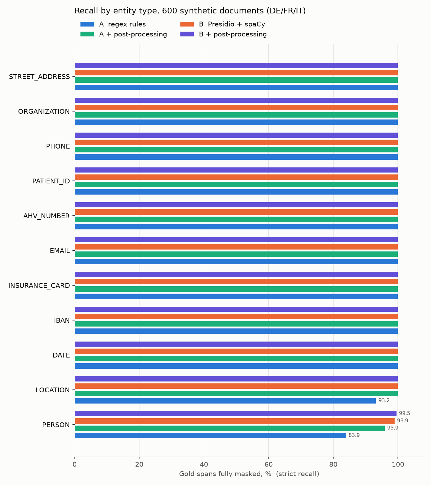
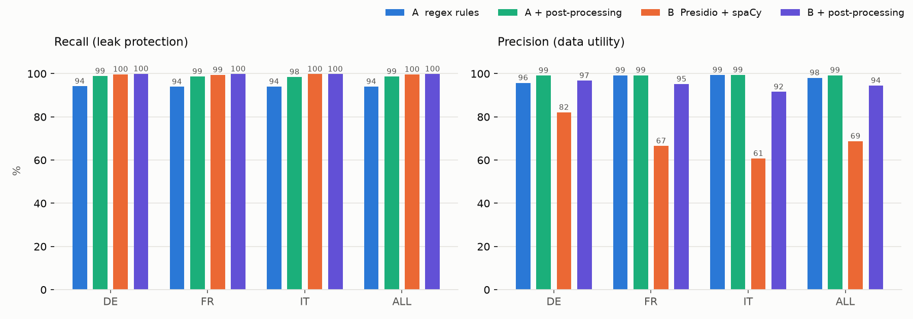
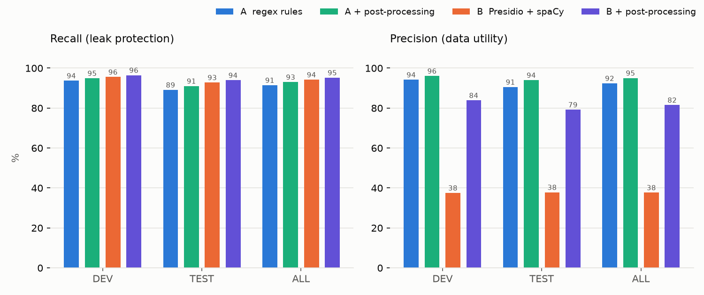
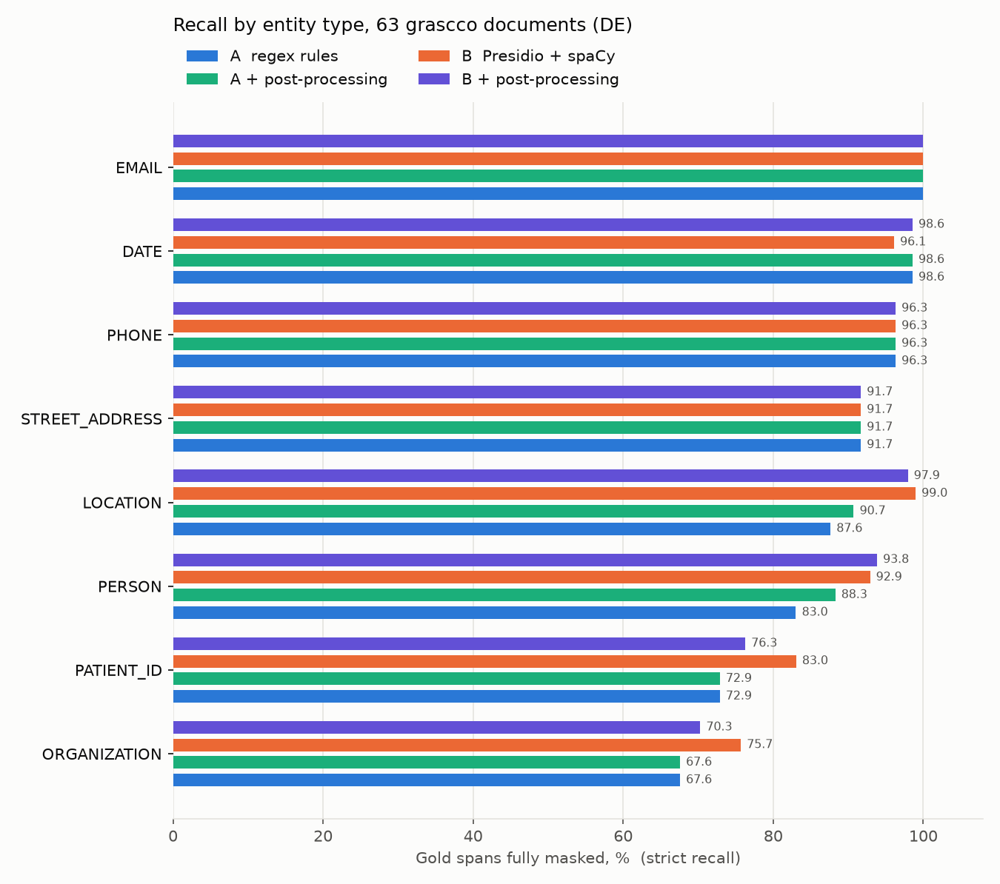

# deid-lab

**Benchmark harness for de-identifying Swiss medical documents (DE / FR / IT) on CPU only.**



*Synthetic referral letter, input on the left, pipeline B output on the right. Note the insurer name masked as ORGANIZATION: a false positive, the price of NER.*

## Highlights

Numbers from the **independent** benchmark, GraSCCo_PII test half (31 German clinical letters,
624 curated PII spans nobody on this project wrote):

| | A: rules | A + post-proc | B: Presidio + spaCy | B + post-proc |
|---|---|---|---|---|
| Recall strict, v0.3 (before tuning) | 50.2 % | 50.2 % | 67.1 % | 67.1 % |
| Recall strict, **v0.4** | 89.1 % | 91.0 % | 92.8 % | **93.9 %** |
| Recall lenient, v0.4 | 90.7 % | 93.1 % | 97.1 % | **96.5 %** |
| Precision, v0.4 | 90.5 % | **94.0 %** | 37.8 % | 79.2 % |
| Speed, ms/doc (1 core, long letters) | 8 | 10 | ~135 | ~140 |

Same code on our own synthetic corpus (600 documents, 11 009 spans): A_pp 98.7 %, B_pp 99.9 % recall,
B_pp precision 94.5 %. The gap between the two corpora is the whole point of this project.

## Table of contents

- [What it does](#what-it-does)
- [Entity catalog](#entity-catalog)
- [Synthetic corpus](#synthetic-corpus)
- [Pipelines](#pipelines)
- [Post-processing](#post-processing)
- [Results](#results)
- [Side-by-side viewer](#side-by-side-viewer)
- [External benchmarks](#external-benchmarks)
- [What the external benchmark changed](#what-the-external-benchmark-changed)
- [Quick start](#quick-start)
- [Project layout](#project-layout)
- [Known limits and next steps](#known-limits-and-next-steps)

## What it does

1. Generates synthetic Swiss medical documents with **exact gold spans** for every PII value.
2. Runs competing detection pipelines over the same corpus.
3. Measures leaks (recall), over-masking (precision) and speed, per entity and per language.
4. Writes masked samples, a full leak list and the top false positives for manual review.

No real patient data is used anywhere. Real samples go to `data/real/`, which is git-ignored.

## Entity catalog

`catalog/entities.yaml` is the single source of truth for what gets removed: 11 labels split into
**direct** identifiers (PERSON, AHV_NUMBER, INSURANCE_CARD, PATIENT_ID, PHONE, EMAIL, IBAN, STREET_ADDRESS)
and **quasi** identifiers (DATE, LOCATION, ORGANIZATION). Baseline is HIPAA Safe Harbor, adapted to Swiss
formats. Open decisions for the business are marked `decision:` in the file
(physician names, date shifting vs year-only, canton generalisation, hospital names).

Explicitly **not** PII and counted as false positive when masked: diagnoses including eponyms
(Morbus Parkinson), medication, ICD codes, lab parameters, insurer names.

## Synthetic corpus

`deidlab/generator.py` builds discharge letters, lab reports and referral letters from templates.
Each PII value enters through a slot, so offsets are known exactly. Faker (`de_CH`, `fr_CH`, `it_IT`)
supplies names, real PLZ/locality pairs supply places, AHV numbers carry a valid EAN-13 check digit.

Hard cases built in on purpose:

- names in free text without honorific, first name only, signature blocks
- surname-first and UPPERCASE surnames (French style)
- lowercase honorifics in Italian prose (`la signora Bianchi`)
- eponymous diagnoses and insurer names as distractors

## Pipelines

| Pipeline | Components | Needs |
|---|---|---|
| **A_regex** | Swiss rules: AHV with checksum, insurance card, CH IBAN, phone +41/0041/0xx, PID/case numbers with context keywords, numeric and written dates DE/FR/IT, street patterns, PLZ + locality, hospital keywords, honorific + name, field label + name | Python only |
| **B_presidio** | Presidio Analyzer, spaCy `*_core_news_lg` NER for DE/FR/IT, Presidio built-ins (email, IBAN, phone CH, dates) plus all A rules as a custom recognizer | ~2.7 GB RAM with three lg models loaded |

Both expose `analyze(text, lang) -> list[Span]`, so new pipelines plug in without touching evaluation.

## Post-processing

`deidlab/postprocess.py` wraps any pipeline (`A_regex_pp`, `B_presidio_pp`) with three document-level steps:

| Step | What it does | Why |
|---|---|---|
| Deny list | drops salutations and bare titles (`Frau Kollegin`, `Chers Collègues`, `Dr`) | rule and NER false positives |
| Propagation | a value found once is masked everywhere in the document: full value, name parts, city from `PLZ City`, locality from a hospital name | one unmasked copy of a name de-anonymises every masked copy |
| Person linking | `Schwab Vivien`, `Vivien Schwab`, `Frau Schwab` get one token `<PERSON_1>`; relatives with the same surname stay separate | downstream analytics must see one person, not three |

Rules also cover two document conventions: French UPPERCASE surnames after field labels and signature blocks (a name line followed by a role line such as `Assistenzarzt`).

## Results


*Strict recall: share of gold spans masked completely. Structured identifiers are solved by rules alone; the gap is in names and places.*


*Recall and precision per language. NER closes the leak gap but over-masks form labels, lab parameters and drug names, worst in FR and IT.*

What the run says:

- **Rules are enough for structured identifiers.** AHV, insurance card, IBAN, phone, PID, dates, streets: 100 % in every pipeline.
- **Post-processing is the cheapest big win.** Propagation lifts A from 90.5 % to 98.1 % recall with zero false positives and leaves B with 6 leaked spans out of 11 009.
- **B still over-masks.** About 4 100 false positives remain: field labels, table headers, lab parameters, drug and insurer names. Next work item: a utility filter for B.
- **A + post-processing looks almost as good as B on this corpus, but do not read too much into it.** The rules were written by the same author as the templates, so they fit these formats by construction. NER generalises to phrasing nobody anticipated; rules do not. The independent benchmark (GraSCCo) decides.
- **CPU is not the bottleneck.** ~30 ms per document for B means roughly 100k documents per hour per worker process.

Full numbers: [`reports/synthetic/REPORT.md`](reports/synthetic/REPORT.md).

## Side-by-side viewer

`reports/<dataset>/compare.html` is a single offline HTML file (no server, no internet). Open it in any browser.

- left: input with every gold PII span coloured by outcome for the selected pipeline: masked, partial leak, missed
- right: masked output; leaked text highlighted red, false-positive tokens outlined orange (hover shows the original)
- switch pipelines, filter to documents with leaks or false positives, filter by language, full-text search, `j`/`k` to step

## External benchmarks

Our generator and our rules share an author, so synthetic scores are optimistic. Two independent corpora:

| Dataset | Content | Languages | Licence | Scored labels |
|---|---|---|---|---|
| **GraSCCo_PII** (Zenodo, GeMTeX) | 63 synthetic German clinical letters, manually curated PII, split 32 dev / 31 test by document | DE | CC-BY-4.0 | NAME, DATE, STREET/ZIP/CITY, HOSPITAL, ID, PHONE/FAX/EMAIL |
| **ai4privacy** open-pii-masking-500k | generic texts (forms, mails, chats), many countries | DE / FR / IT | CC-BY-4.0 | names, dates, addresses, phones, e-mails, national IDs, cards |

Labels outside the catalog (TITLE, AGE, SEX, TIME, PROFESSION, COUNTRY) are not scored and are listed in `data/<dataset>/import_stats.json`.
Rules and filters are tuned on the GraSCCo **dev** half only; every number quoted here is from **test**.


*GraSCCo_PII after tuning. NER plus post-processing leaks the least; rules plus post-processing has the best precision.*


*Per entity on GraSCCo. Organisations and patient IDs remain the weak categories: institution names span several lines, and ward/room numbers are only recognisable from context.*

```bash
# [ansible@srv-anaconda-01]  (deid)
python scripts/10_fetch_external.py          # downloads to data/external_raw/ (~145 MB)
python scripts/11_import_ai4privacy.py       # -> data/ai4privacy/docs.jsonl (500 texts per language)
python scripts/12_import_grascco.py          # -> data/grascco/docs.jsonl, dev/test split
DEID_DATASET=grascco    ./run_eval.sh        # runs A/B/+pp, report + viewer in reports/grascco/
DEID_DATASET=ai4privacy ./run_eval.sh
```

## What the external benchmark changed

v0.3 scored 99.9 % on synthetic data and 67 % on GraSCCo. Reading the leaks produced four fixes, all measured on dev and verified on test:

| Finding on GraSCCo | Fix | Test recall effect |
|---|---|---|
| Rules knew Swiss formats only: no `0341/97-12345`, no 5-digit ZIP, no `Universitätsklinikum`, no `Str.` | German/Austrian phones, ZIPs, hospital vocabulary, street suffixes, ID keywords (`PIZ`, `Fallzahl`, `E-Nr`) | A 50 % → 85 % |
| GeMTeX annotates partial dates and bare years (`11/18`, `Z.n. Mamma-Ca 2037`): 172 of 227 date leaks | month/year, day.month., month-name, range starts, bare years with a dose guard; catalog decision recorded | DATE 66 % → 99 % |
| Names without honorific: `Luise Utz, * 3.4.1959`, signatures, `Haefner, Heinz`, initials `K. O. von Hausen` | birth-marker rule, signature rules, surname-first rule, initials with eponym guard (`M. Crohn`) | PERSON 51 % → 85 % (A) |
| spaCy tags anatomy, drugs and lab abbreviations as entities: 35 false positives per letter | utility filter on NER spans: shape checks, clinical vocabulary (`deidlab/medical_terms.py`), org keyword requirement, corroboration for single-token names | B precision 38 % → 79 %, recall unchanged |

The filter has two domain-sensitive heuristics (uncorroborated single-token names, cities without a locative
preposition). On GraSCCo each is worth ~15 points of precision at no recall cost; on short generic texts
(ai4privacy) they drop real names and cities. `FILTER_PROFILE = "clinical"` (default) keeps them,
`DEID_FILTER_PROFILE=generic ./run_eval.sh` turns them off. ai4privacy numbers are quoted with `generic`.

Two engineering lessons worth keeping:

- **Presidio keeps one result per text range.** When NER and a rule find the same span, the NER copy wins, so a filter on NER spans silently removed rule hits (`Frau Albers`). Post-processing now re-adds the rules' own output before filtering.
- **Propagation amplifies whatever seeds it.** Only spans with score >= 0.7 seed propagation now; weak heuristics would otherwise spread their errors through the document.

What is left on GraSCCo test is mostly out of reach for rules: first names in free text (`Marija`, `Maria`), multi-line institution headers, ward designations (`Intensiv II`), and a few phones without area code.

## Quick start

Code lives on the NFS share, the conda environment on local disk.

```bash
# [ansible@srv-anaconda-01]  (NFS 170.168.1.30:/nfs/shared mounted)
cd /nfs/shared/projects/deid-lab
mamba env create -f environment.yml          # Python 3.11 env "deid", independent of RHEL 8 system python
conda activate deid                          # activate via conda; mamba 2.x needs its own shell hook
pip config --site set global.index-url https://pypi.org/simple   # this env only, host mirror untouched
pip install -r requirements.txt
python -m spacy download de_core_news_lg
python -m spacy download fr_core_news_lg
python -m spacy download it_core_news_lg
./run_all.sh                                 # generate -> run all pipelines -> evaluate -> report
```

`run_all.sh` regenerates the synthetic corpus; `run_eval.sh` only re-runs pipelines and the report
on the dataset from `config.py` (or `DEID_DATASET=...`).

Full cycle `run_all.sh` with all four pipelines: one to two minutes on one core, most of it B and the spaCy model load. GraSCCo letters are long (up to 100 kB), B takes ~140 ms each there. The seed is fixed, so the numbers reproduce exactly.

Tuning lives in `config.py` (dataset, corpus size, languages, pipelines, spaCy model size, score threshold). No CLI flags.

## Project layout

```
deid-lab/
├── config.py                    # all paths and parameters, DATASET switch
├── run_all.sh / run_eval.sh
├── catalog/entities.yaml        # what to remove, open business decisions
├── deidlab/
│   ├── swiss_data.py            # PLZ/localities, street and hospital patterns, distractors
│   ├── generator.py             # templates DE/FR/IT + gold spans
│   ├── rules.py                 # Swiss regex rules + validators (pipeline A)
│   ├── pipelines.py             # A_regex, B_presidio, merge, masking
│   ├── postprocess.py           # deny list, NER utility filter, propagation, person linking (*_pp)
│   ├── medical_terms.py         # clinical vocabulary for the utility filter
│   └── evaluate.py              # coverage-based leak and precision metrics
├── scripts/
│   ├── 01_generate.py           # synthetic corpus
│   ├── 02_run_and_evaluate.py
│   ├── 03_report.py             # REPORT.md, figures, compare.html
│   ├── compare_template.html
│   ├── 10_fetch_external.py     # GraSCCo_PII + ai4privacy downloads
│   ├── 11_import_ai4privacy.py
│   └── 12_import_grascco.py
├── data/<dataset>/              # docs.jsonl + txt (generated / imported)
├── runs/<dataset>/<pipeline>/   # predictions, leaks.csv, false_positives_top.csv, masked/
└── reports/<dataset>/           # REPORT.md, figures/, compare.html
```

## Known limits and next steps

- **Optimistic bias on synthetic data.** Quote GraSCCo test numbers. GraSCCo is itself synthetic and German; Swiss client documents will differ again, so a client sample set is the next benchmark.
- **B precision.** 79 % on GraSCCo test. The remaining false positives are propagated organ-surnames (`Leber`, `Hals`) and NER phrases with adjectives; a transformer PII model (pipeline C) should replace most of the hand-made filter.
- **Pipeline C.** Transformer PII model (GLiNER or a multilingual privacy-filter model) via Presidio on CPU, then **D** as the combined production candidate.
- **File formats.** Today plain text. Next: DOCX, text PDF, scanned PDF with OCR, document metadata.
- **Real formats.** PID and case-number patterns must be collected from real client samples before any production use.
