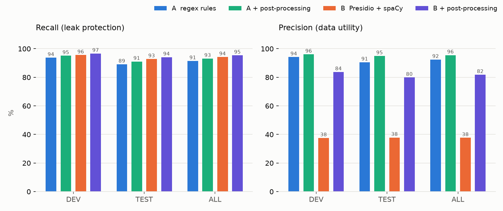

# deid-lab evaluation report: grascco

Corpus: 63 grascco documents (DE), 1274 gold PII spans. Tuning on **dev**, numbers to quote are **test**.

| Pipeline | Recall strict | Recall lenient | Precision | False positives | ms/doc | Model load |
|---|---|---|---|---|---|---|
| A_regex | 91.4% | 92.7% | 92.4% | 94 | 7.6 | 0.0 s |
| A_regex_pp | 93.1% | 94.8% | 95.5% | 55 | 8.3 | 0.0 s |
| B_presidio | 94.2% | 97.8% | 37.7% | 2003 | 133.2 | 8.83 s |
| B_presidio_pp | 95.4% | 97.1% | 81.8% | 267 | 122.9 | 7.3 s |

| Pipeline | dev recall | test recall | dev precision | test precision |
|---|---|---|---|---|
| A_regex | 93.7% | 89.1% | 94.2% | 90.5% |
| A_regex_pp | 95.1% | 91.0% | 96.1% | 94.9% |
| B_presidio | 95.5% | 92.8% | 37.5% | 37.8% |
| B_presidio_pp | 96.6% | 94.1% | 83.7% | 79.9% |

## Strict recall per entity and language

| Entity | A_regex DE | A_regex_pp DE | B_presidio DE | B_presidio_pp DE |
|---|---|---|---|---|
| ORGANIZATION | 67.6 | 67.6 | 75.7 | 70.3 |
| PATIENT_ID | 72.9 | 72.9 | 83.0 | 76.3 |
| PERSON | 83.0 | 88.6 | 92.9 | 94.4 |
| LOCATION | 87.6 | 90.7 | 99.0 | 97.9 |
| STREET_ADDRESS | 91.7 | 91.7 | 91.7 | 91.7 |
| PHONE | 96.3 | 96.3 | 96.3 | 96.3 |
| DATE | 98.6 | 98.6 | 96.1 | 98.6 |
| EMAIL | 100.0 | 100.0 | 100.0 | 100.0 |

Side-by-side viewer: `reports/grascco/compare.html`.
Details per pipeline: `runs/grascco/<pipeline>/leaks.csv`, `false_positives_top.csv`, `metrics_by_entity.csv`, masked output in `runs/grascco/<pipeline>/masked/`.
