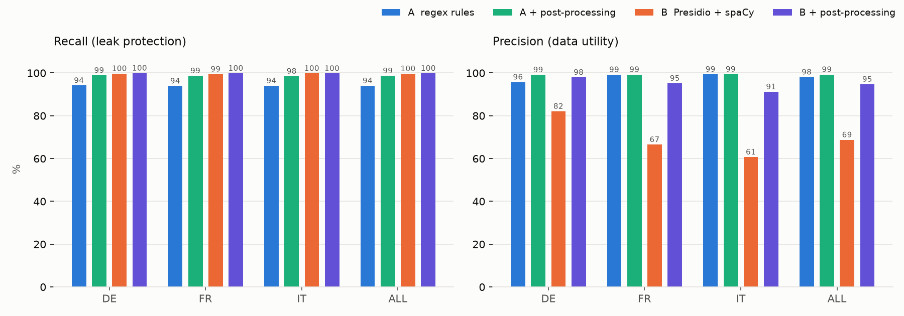

# deid-lab evaluation report: synthetic

Corpus: 600 synthetic documents (DE/FR/IT), 11009 gold PII spans.

| Pipeline | Recall strict | Recall lenient | Precision | False positives | ms/doc | Model load |
|---|---|---|---|---|---|---|
| A_regex | 94.0% | 94.0% | 98.1% | 202 | 1.8 | 0.0 s |
| A_regex_pp | 98.7% | 99.2% | 99.3% | 79 | 3.0 | 0.0 s |
| B_presidio | 99.7% | 99.7% | 68.8% | 4988 | 34.3 | 6.9 s |
| B_presidio_pp | 99.9% | 99.9% | 94.7% | 612 | 36.0 | 0.0 s |

## Strict recall per entity and language

| Entity | A_regex DE | A_regex FR | A_regex IT | A_regex_pp DE | A_regex_pp FR | A_regex_pp IT | B_presidio DE | B_presidio FR | B_presidio IT | B_presidio_pp DE | B_presidio_pp FR | B_presidio_pp IT |
|---|---|---|---|---|---|---|---|---|---|---|---|---|
| PERSON | 84.4 | 83.1 | 84.2 | 96.5 | 95.9 | 95.2 | 99.2 | 98.3 | 99.4 | 99.8 | 99.6 | 99.3 |
| LOCATION | 92.8 | 94.4 | 92.4 | 100.0 | 100.0 | 100.0 | 100.0 | 100.0 | 100.0 | 100.0 | 100.0 | 100.0 |
| PHONE | 100.0 | 100.0 | 100.0 | 100.0 | 100.0 | 100.0 | 100.0 | 100.0 | 100.0 | 100.0 | 100.0 | 100.0 |
| DATE | 100.0 | 100.0 | 100.0 | 100.0 | 100.0 | 100.0 | 100.0 | 100.0 | 100.0 | 100.0 | 100.0 | 100.0 |
| STREET_ADDRESS | 100.0 | 100.0 | 100.0 | 100.0 | 100.0 | 100.0 | 100.0 | 100.0 | 100.0 | 100.0 | 100.0 | 100.0 |
| INSURANCE_CARD | 100.0 | 100.0 | 100.0 | 100.0 | 100.0 | 100.0 | 100.0 | 100.0 | 100.0 | 100.0 | 100.0 | 100.0 |
| IBAN | 100.0 | 100.0 | 100.0 | 100.0 | 100.0 | 100.0 | 100.0 | 100.0 | 100.0 | 100.0 | 100.0 | 100.0 |
| ORGANIZATION | 100.0 | 100.0 | 100.0 | 100.0 | 100.0 | 100.0 | 100.0 | 100.0 | 100.0 | 100.0 | 100.0 | 100.0 |
| AHV_NUMBER | 100.0 | 100.0 | 100.0 | 100.0 | 100.0 | 100.0 | 100.0 | 100.0 | 100.0 | 100.0 | 100.0 | 100.0 |
| PATIENT_ID | 100.0 | 100.0 | 100.0 | 100.0 | 100.0 | 100.0 | 100.0 | 100.0 | 100.0 | 100.0 | 100.0 | 100.0 |
| EMAIL | 100.0 | 100.0 | 100.0 | 100.0 | 100.0 | 100.0 | 100.0 | 100.0 | 100.0 | 100.0 | 100.0 | 100.0 |

Side-by-side viewer: `reports/synthetic/compare.html`.
Details per pipeline: `runs/synthetic/<pipeline>/leaks.csv`, `false_positives_top.csv`, `metrics_by_entity.csv`, masked output in `runs/synthetic/<pipeline>/masked/`.
