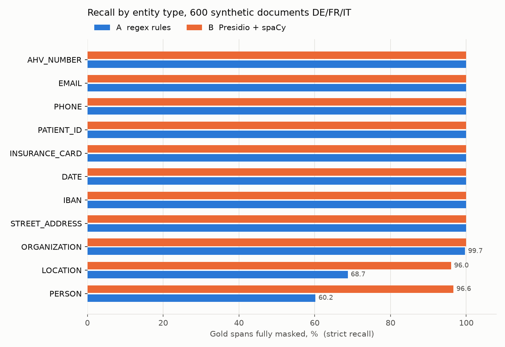
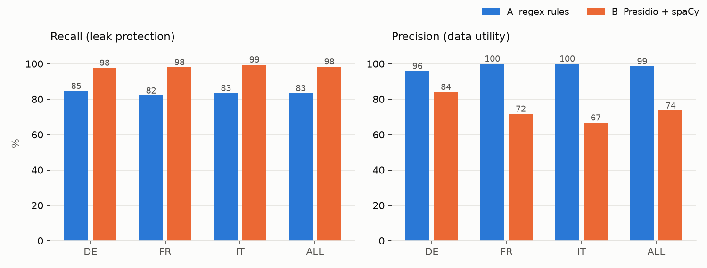

# deid-lab evaluation report

Corpus: 600 synthetic documents (de, fr, it), 11009 gold PII spans.

| Pipeline | Recall strict | Recall lenient | Precision | False positives | ms/doc | Model load |
|---|---|---|---|---|---|---|
| A_regex | 83.4% | 83.8% | 98.6% | 134 | 0.5 | 0.0 s |
| B_presidio | 98.4% | 98.8% | 73.5% | 3893 | 49.8 | 12.27 s |

## Strict recall per entity and language

| Entity | A_regex DE | A_regex FR | A_regex IT | B_presidio DE | B_presidio FR | B_presidio IT |
|---|---|---|---|---|---|---|
| PERSON | 62.5 | 58.2 | 59.9 | 96.8 | 94.4 | 98.6 |
| LOCATION | 72.5 | 63.3 | 70.2 | 89.8 | 98.7 | 99.4 |
| ORGANIZATION | 99.0 | 100.0 | 100.0 | 100.0 | 100.0 | 100.0 |
| STREET_ADDRESS | 100.0 | 100.0 | 100.0 | 100.0 | 100.0 | 100.0 |
| IBAN | 100.0 | 100.0 | 100.0 | 100.0 | 100.0 | 100.0 |
| DATE | 100.0 | 100.0 | 100.0 | 100.0 | 100.0 | 100.0 |
| INSURANCE_CARD | 100.0 | 100.0 | 100.0 | 100.0 | 100.0 | 100.0 |
| PATIENT_ID | 100.0 | 100.0 | 100.0 | 100.0 | 100.0 | 100.0 |
| PHONE | 100.0 | 100.0 | 100.0 | 100.0 | 100.0 | 100.0 |
| EMAIL | 100.0 | 100.0 | 100.0 | 100.0 | 100.0 | 100.0 |
| AHV_NUMBER | 100.0 | 100.0 | 100.0 | 100.0 | 100.0 | 100.0 |

Details per pipeline: `runs/<pipeline>/leaks.csv`, `false_positives_top.csv`, `metrics_by_entity.csv`, masked samples in `runs/<pipeline>/masked/`.
