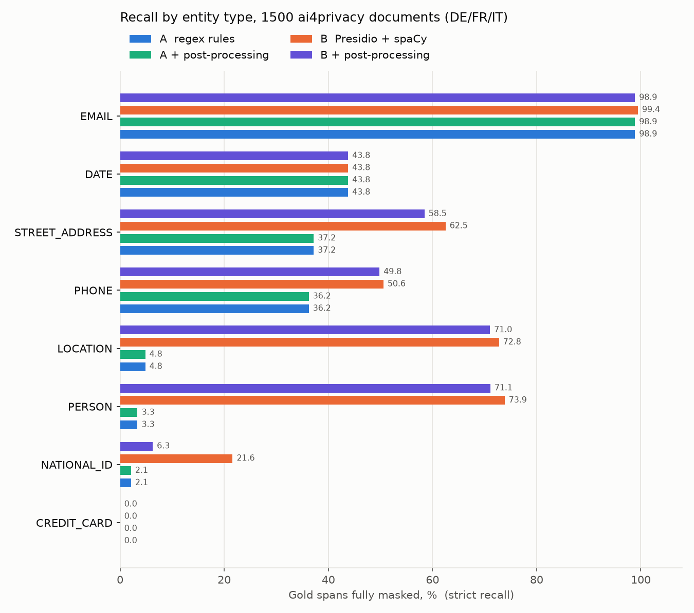
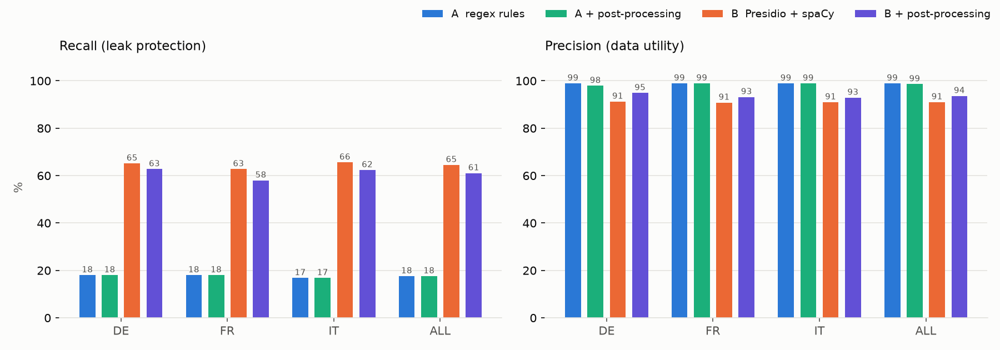

# deid-lab evaluation report: ai4privacy

Corpus: 1500 ai4privacy documents (DE/FR/IT), 3028 gold PII spans.

| Pipeline | Recall strict | Recall lenient | Precision | False positives | ms/doc | Model load |
|---|---|---|---|---|---|---|
| A_regex | 17.6% | 20.9% | 98.9% | 6 | 0.4 | 0.0 s |
| A_regex_pp | 17.6% | 20.9% | 98.6% | 8 | 0.4 | 0.0 s |
| B_presidio | 64.5% | 69.4% | 91.0% | 179 | 11.3 | 11.17 s |
| B_presidio_pp | 61.1% | 65.9% | 93.6% | 117 | 11.5 | 0.0 s |

## Strict recall per entity and language

| Entity | A_regex DE | A_regex FR | A_regex IT | A_regex_pp DE | A_regex_pp FR | A_regex_pp IT | B_presidio DE | B_presidio FR | B_presidio IT | B_presidio_pp DE | B_presidio_pp FR | B_presidio_pp IT |
|---|---|---|---|---|---|---|---|---|---|---|---|---|
| CREDIT_CARD | 0.0 | 0.0 | 0.0 | 0.0 | 0.0 | 0.0 | 0.0 | 0.0 | 0.0 | 0.0 | 0.0 | 0.0 |
| NATIONAL_ID | 0.9 | 5.0 | 1.0 | 0.9 | 5.0 | 1.0 | 9.2 | 38.8 | 21.4 | 2.8 | 8.8 | 8.2 |
| PERSON | 2.4 | 4.0 | 3.6 | 2.4 | 4.0 | 3.6 | 77.8 | 67.4 | 76.3 | 74.6 | 64.8 | 73.9 |
| LOCATION | 11.0 | 3.2 | 1.8 | 11.0 | 3.2 | 1.8 | 69.5 | 66.0 | 80.7 | 69.5 | 62.8 | 79.0 |
| PHONE | 43.9 | 31.0 | 34.4 | 43.9 | 31.0 | 34.4 | 56.1 | 50.6 | 45.8 | 56.1 | 49.4 | 44.8 |
| STREET_ADDRESS | 37.8 | 31.9 | 40.9 | 37.8 | 31.9 | 40.9 | 58.9 | 57.1 | 69.6 | 57.8 | 51.6 | 64.3 |
| DATE | 49.0 | 53.1 | 31.9 | 49.0 | 53.1 | 31.9 | 49.0 | 53.1 | 31.9 | 49.0 | 53.1 | 31.9 |
| EMAIL | 100.0 | 96.8 | 100.0 | 100.0 | 96.8 | 100.0 | 100.0 | 98.4 | 100.0 | 100.0 | 96.8 | 100.0 |

Side-by-side viewer: `reports/ai4privacy/compare.html`.
Details per pipeline: `runs/ai4privacy/<pipeline>/leaks.csv`, `false_positives_top.csv`, `metrics_by_entity.csv`, masked output in `runs/ai4privacy/<pipeline>/masked/`.
